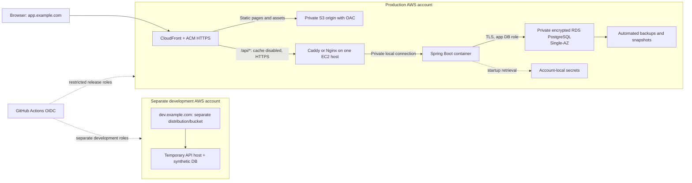

# NextSITREP production readiness and AWS deployment recommendation

Assessment/pricing date: November 2, 2026 (America/New_York). Repository: `/Users/agoge/Developer/repos/github/veterans-connect`, base commit `5a99f2f` plus existing working-tree edits. Currency: USD. Planning region: **US East (N. Virginia), us-east-1**. Different regions, actual traffic, taxes and operating requirements change the estimate.

## Recommendation and readiness verdict

**Current status: not ready for production veteran data.** The repository contains a Next.js 16/React frontend, Java 21-targeted Spring Boot REST API, PostgreSQL persistence and Flyway migrations. Local containers and CI checks exist; AWS account configuration, infrastructure, domain ownership, deployment automation, secrets, backups and recovery readiness are not established by the repository. No cloud account was inspected or changed during this assessment.

**Recommended target after application remediation:** validate a static Next.js frontend export, serve it from private S3 through CloudFront, route the same browser origin's `/api/*` to one small EC2 Spring Boot host, and use an encrypted, private, Single-AZ RDS PostgreSQL database. Keep separate development and production accounts, credentials, data, deployment roles and infrastructure stacks. Use temporary development compute with synthetic data, not a second always-on production-sized stack.

Budget reality, assuming the $30–$40 goal covers **both workload accounts together**:

- A reasonable initial 2 GB API-host estimate is **$40.54/month AWS services**, or **$42.04 including an assumed $18/year domain renewal**. Plan roughly **$40–$45**, with contingency above that.
- A 1 GB API host reduces the model to **$35.91 including that domain**, approximately **$35–$40**, **only after memory, CPU, deployment and load tests pass**. This is an optimization candidate, not validated capacity.
- Keeping the existing Next.js server runtime alongside Spring may require a 4 GB host; the corresponding estimate is about **$54/month**, before extra capacity/traffic.
- Two continuously running managed development/production stacks are roughly **$70–$85/month** with the modeled sizes/controls. Multi-AZ application/database availability is a separate higher-budget tier.

Do not force the budget by exposing PostgreSQL publicly, removing backups/encryption, accepting known application security flaws, or relying on promotional credits. A single application host and Single-AZ database are a conscious availability tradeoff; they do not provide enterprise high availability. Enterprise principles here mean isolation, least privilege, reproducible delivery, traceability, recoverability and explicit risk ownership.

No dependencies were installed, code/configuration was modified, AWS resources were created, or deployments were attempted. Only this document was added. Cost verification used public AWS documentation/catalogs without account credentials.

## Current evidence and deployment blockers

The existing [project audit](/Users/agoge/Developer/repos/github/veterans-connect/PROJECT_AUDIT.md), [frontend audit](/Users/agoge/Developer/repos/github/veterans-connect/FRONTEND_AUDIT.md) and [backend audit](/Users/agoge/Developer/repos/github/veterans-connect/BACKEND_AUDIT.md) document code-level findings; current Dockerfiles, application properties and workflows were rechecked for this assessment. Prior checks are identified as prior evidence rather than represented as rerun here: frontend build/types/8 tests pass, frontend formatting fails, and backend clean verify runs 105 passing tests but fails 70% coverage at **61.64%**. No production container, ARM64 runtime, static export, load/restore test, or AWS deployment has yet been verified.

| Priority | Blocker / evidence | Application change | Infrastructure / operations change |
| --- | --- | --- | --- |
| Critical | Known fallback JWT signing key: [backend/src/main/resources/application.properties:22–32](/Users/agoge/Developer/repos/github/veterans-connect/backend/src/main/resources/application.properties:22); backend B01 | Reject fallback/missing/weak signing settings at startup | Independent account/environment secrets and tested rotation |
| High | Old Next/React/Spring dependencies, including a confirmed affected Spring Security version; backend B02, frontend F01 | Upgrade/test supported compatible releases; fix relevant advisories | Artifact/image scans and patch ownership; hosting alone does not fix vulnerable code |
| High | Browser CSRF assumes readable API-host cookie; backend B11 | Validate a same-origin API contract; keep CSRF protection | Route `/api/*` under each environment's frontend hostname; preserve cookies/headers |
| High | `NEXT_PUBLIC_API_BASE_URL` defaults to localhost and is compiled into browser JS: [frontend/lib/api.ts:12–13](/Users/agoge/Developer/repos/github/veterans-connect/frontend/lib/api.ts:12) | Produce a verified relative same-origin build; no production localhost fallback | Promote the same environment-neutral frontend artifact; route origins per account |
| High | `prod` profile adds no safeguards; cookie Secure=false and local DB defaults remain: [backend/src/main/resources/application.properties:9–50](/Users/agoge/Developer/repos/github/veterans-connect/backend/src/main/resources/application.properties:9) | Validated production settings, safe errors and session lifecycle | TLS, private DB, secret injection, proxy trust, least-privilege DB users |
| High | Weak/unbounded auth limiter and missing search/provider quotas; B04/B18 | Bounded abuse controls, request budgets and provider policy enforcement | Trusted ingress/client-IP normalization, traffic and cost alerts |
| High | Sign-out can leave an active session; unverified/stale resource claims and sensitive logs; F03/B05/B12–B15 | Defined revocation/recovery, source/freshness semantics, redaction and privacy process | Restricted logs/backups/secrets with retention and an incident owner |
| High | CI omits frontend tests and backend verify; current formatting/coverage fail: [.github/workflows/ci.yml:54–58](/Users/agoge/Developer/repos/github/veterans-connect/.github/workflows/ci.yml:54), [.github/workflows/ci.yml:100–115](/Users/agoge/Developer/repos/github/veterans-connect/.github/workflows/ci.yml:100) | Risk-focused tests and fixes; green required checks | Protected deployment jobs, traceable artifacts and promotion controls |
| High | No tested PostgreSQL backup/restore, migration rollout or account deletion process; B26/B27 | Compatible migrations and usable privacy workflows | Encrypted backups, tested recovery targets, deletion protection and runbooks |
| High | Essential accessibility defects, especially dialog focus/name and contrast; F15/F17 | Fix core accessibility/user feedback before public release | Browser/accessibility checks in release gate |
| Medium | Response timestamps are null/stale at save/update; B23 | Map after authoritative timestamp generation; persistence tests | Verify with intended RDS engine, not only H2 |
| Medium | Containers float tags, lack non-root hardening and runtime validation: Dockerfiles | Minimal tested artifacts, non-root execution and health/shutdown behavior | Pinned AMI/image digests, memory limits, monitoring and replacement procedure |
| Medium | No infrastructure/deployment definition | Add only the necessary deployment/migration entry points | Reviewed IaC, per-account bootstrap, DNS/certificates/IAM/rollback |

Approval to implement this plan would be separate from approval to deploy. Public enrollment should remain closed until the agreed release gates pass. Synthetic-data development may proceed after essential baseline controls are implemented and approved.

## Recommended AWS architecture

### Production target

The diagram is proposed design, not existing infrastructure. Example domains are placeholders and do not imply ownership.

1. **Frontend:** S3 REST origin, Block Public Access enabled, bucket-owner-enforced ownership, CloudFront Origin Access Control scoped to the exact distribution. Do not use the S3 website endpoint: OAC does not apply to it. Use immutable content-hashed assets and short-lived/revalidated HTML. See [AWS OAC guidance](https://docs.aws.amazon.com/AmazonCloudFront/latest/DeveloperGuide/private-content-restricting-access-to-s3.html).
2. **API:** one Linux ARM64 EC2 host, initially **t4g.small (2 GiB)**, with encrypted 20 GiB gp3 root volume, managed instance profile and SSM administration. Spring runs in a tested ARM64 Java 21 container; proxy and deployment agent run on the host or as controlled containers. Bind 8080 locally/private container network. No production builds run on this small host.
3. **Database:** **RDS PostgreSQL db.t4g.micro (1 GiB), Single-AZ, 20 GiB gp3**, encrypted at creation, not publicly accessible. Choose an engine version in standard support and validated with the upgraded app/Flyway; do not blindly copy the local Postgres 15 image tag. Same-AZ placement reduces cross-AZ traffic, while the DB subnet group still spans at least two AZs. This does not create a Multi-AZ standby. See [RDS VPC guidance](https://docs.aws.amazon.com/AmazonRDS/latest/UserGuide/USER_VPC.WorkingWithRDSInstanceinaVPC.html).
4. **Network:** public app-host subnet with an Internet Gateway and one billed IPv4/EIP for outbound VA/Nominatim, ECR, SSM, updates and secret calls. Database subnets have local VPC routing without public ingress. **No NAT Gateway or interface endpoints in the baseline.** A public host subnet does not require public app/database ports.
5. **Origin access:** restrict API-origin HTTPS security-group ingress to the AWS-managed CloudFront origin-facing prefix list; validate a per-environment origin-secret header at the proxy so another distribution cannot impersonate this distribution. The header supplements, and never replaces, user authentication/CSRF. Check prefix-list security-group quota weight. See [AWS origin-facing prefix lists](https://docs.aws.amazon.com/AmazonCloudFront/latest/DeveloperGuide/LocationsOfEdgeServers.html).
6. **No SSH ingress or Docker socket exposure.** Use SSM with scoped operator/deployment permissions. Runtime role can pull only release images, retrieve only runtime secrets/config and send only required logs/metrics. It cannot change IAM, deploy infrastructure, read unrelated data or access development.

### Static export is an application decision and release gate

The audited pages currently prerender to static shells and fetch private data through the browser. No Server Actions, Next route handlers, request-time server cookies, ISR, dynamic path catalogue or next/image usage was found. This makes static export a strong **candidate**, not an already proven capability. Current config still runs `next start`.

After approval, validate `output: "export"` with the upgraded framework and all routes/query-string/deep-link flows. Remove/replace the Next response `headers()` function at the serving layer: headers, rewrites and other runtime features are not supported by export. See [Next static export limitations](https://nextjs.org/docs/app/guides/static-exports). Move frontend security headers to CloudFront response-header policies, test directory/HTML path rewrites, and preserve true 404 responses. Do not use a global “all errors → index.html/200” SPA fallback: it can conceal API 401/403/404/5xx failures.

Set the verified browser API base to an intentional same-origin value; the existing nullish fallback accepts an explicitly empty string, but production build validation must distinguish intended empty from accidental missing configuration. Server-side secrets must never be supplied to the static build. Static dashboard/login shells are public assets; authorization must remain in Spring, and no private data may enter exported HTML/RSC artifacts.

If export fails or future SSR/server features become necessary, retain a Next server behind the same ingress. Recalculate memory/cost; a 4 GiB host is the conservative alternative to validate. Do not rewrite the backend into Lambda solely to meet the budget.

### CloudFront API behavior is security-critical

| Behavior | Required configuration / validation |
| --- | --- |
| `/api/*` and explicit API root handling | API custom origin, preserve the existing `/api/v1/...` path; all required methods including POST/PATCH/DELETE/OPTIONS |
| API caching | [CachingDisabled policy](https://docs.aws.amazon.com/AmazonCloudFront/latest/DeveloperGuide/using-managed-cache-policies.html); zero cache TTLs including error caching for these responses; verify live responses and account separation |
| Forwarding | Cookies, Authorization, Origin, X-XSRF-TOKEN, content headers and all required query strings; use a supported origin-request policy such as AllViewerExceptHostHeader after testing; do not assume Authorization is forwarded by default |
| Cookies | Preserve Set-Cookie; host-only session and readable CSRF cookies delivered under app.example.com, Secure in production; never set a shared `.example.com` cookie domain across accounts |
| HTTPS | HTTPS-only viewer/API-origin flow; origin certificate matches origin DNS; verify proxy-forwarded scheme so cookie/HSTS handling is correct |
| Static behavior | No private cookie/header forwarding to S3; stable asset caching, deliberate HTML revalidation and security headers |
| Errors | Preserve Spring's error status/body; do not route API errors to static login/404 pages or cache them |
| Headers/client IP | Strip spoofed forwarding headers at the trusted boundary; derive a canonical viewer IP from the trusted CloudFront/proxy chain. Do not simply enable trust of the leftmost arbitrary X-Forwarded-For value |

Test with two separate synthetic accounts and inspect cache headers/cookies across reads, writes, CSRF failure, expiration, logout and direct-origin attempts. Never cache profile, saved resources, notes, CSRF/bootstrap or authenticated search responses as shared content.

### Development account

- Separate VPC, roles, secrets/parameters, registry/bucket/distribution, DNS subdomain and synthetic user data. No VPC peering, shared production DB, shared JWT key or copied production snapshots.
- Use the same immutable frontend/backend artifacts and same-origin routing. Keep affordable static hosting, IAM and DNS while creating API compute only for planned sessions; model approximately **80 compute-hours/month**.
- For routine integration work, a disposable local PostgreSQL container on the dev API host is acceptable, clearly different from managed production persistence. Before promotion, perform an ephemeral **real RDS/engine/TLS/migration/restore validation** in the dev account. That drill adds metered compute/storage and must be tracked; continuous parity is not assumed within this budget.
- Destroy disposable compute, release dev public IPv4/EIP and delete unwanted EBS volumes/test databases/snapshots after each session. Stopping compute alone does not stop storage/IP charges. [Stopped RDS instances restart after seven days](https://docs.aws.amazon.com/AmazonRDS/latest/UserGuide/USER_StopInstance.html); do not treat “stopped dev RDS” as a permanent zero-cost environment.
- Protect dev deployments from unintended public data collection; use test-only accounts, no real personal data, a synthetic/demo warning and an intentionally scoped access policy. Do not add an unbudgeted ALB solely for dev authentication.

### Hosting options considered

| Option | Fit and approximate implication | Recommendation |
| --- | --- | --- |
| S3/CloudFront export + EC2 API + private encrypted RDS | Fits existing browser-fetch model after export validation; managed data recovery; approximately $42 with 2 GiB API host, $36 with validated 1 GiB host | Preferred target for a small beta |
| EC2 hosting current Next + Spring + RDS | Least change to rendering/deployment model; validate 4 GiB and ARM64; approximately $54–$60 | Fallback if export is unsuitable |
| Lightsail 4 GiB instance with Next + Spring + local PostgreSQL | $24 instance package before backups/logs/domain; aggregate may fit $30–$40; one failure/patching domain and self-managed DB recovery | Prototype/explicit operational tradeoff, not preferred for private production data |
| Lightsail app + managed database | $12 or $24 app plus **at least $30 encrypted standard database**, before other costs; $15 DB tier lists no data encryption | Exceeds target; do not choose unencrypted tier for these data |
| ECS/Fargate/Express Mode + RDS | Container fit is good; ALB/networking and minimum-running resources add meaningful fixed cost; two environments compound it | Later managed-growth path, cost separately |
| App Runner | AWS has closed it to new customers; existing-customer eligibility in both accounts is not established | Not a new-project recommendation |
| Amplify Hosting | Can host Next/static frontend but does not supply the existing Java/PostgreSQL backend; build/SSR usage is additional | Optional alternative to S3/CloudFront, not an all-in backend solution |
| Lambda/API Gateway + database | Spring needs a tested adapter/repackaging/startup/connection design; neither exists here; RDS Proxy or Aurora adds cost | Do not adopt solely from a “serverless is free” assumption |

AWS sources: [Lightsail plans/encryption](https://aws.amazon.com/lightsail/pricing/); [App Runner availability and ECS Express resources](https://docs.aws.amazon.com/apprunner/latest/dg/apprunner-availability-change.html). Express Mode has no extra service fee, but creates paid Fargate/ALB/network resources. The Lightsail quote includes its bundled public IPv4; do not add EC2 IPv4 charges a second time to that package. Lightsail does not provide the ordinary EC2 instance-profile model for this design; secure secret retrieval/backup credentials would require a separate evaluated mechanism. Do not quietly place permanent AWS keys on it.

## Estimated recurring monthly cost

### Assumptions and pricing evidence

- 730-hour planning month, on-demand Linux ARM64 in us-east-1, no Savings Plan/Reserved Instance, credits or promotional Free Tier deductions.
- One production API host, one private Single-AZ production database, and temporary development compute for 80 hours/month. DB is small (initially under 5 GiB); root storage 20 GiB, RDS storage 20 GiB; baseline included gp3 IOPS/throughput only.
- Low traffic: about 10 GB/month frontend delivery, 100,000 HTTPS requests and little DB/network traffic; about 0.5 GB/month redacted log ingestion. Model includes a small edge/backup/monitoring allowance even where ongoing included service allowances may lower the bill. Such ongoing pricing features are not promotional credits, but the budget does not depend on receiving a $200 credit.
- Four production Secrets Manager secrets assumed, e.g. runtime DB credential, runtime auth/provider/origin configuration, privileged DB master and isolated migration credential. Only the appropriate role reads each. Dev can use account-local standard SecureString parameters and synthetic credentials. Grouping values is not a reason to grant the app access to privileged DB secrets.
- AWS-managed encryption keys assumed. Customer-managed KMS keys, extra encryption API use, cross-region/cross-account backup copies and recovery drills can add cost.
- One production parent DNS zone and one delegated dev zone, four GiB retained container images across accounts, limited manual/snapshot storage, no paid support plan. The domain assumption is **$18/year**, not a quote for an owned/available TLD; verify purchase/renewal separately.

EC2 hourly prices were read from the [AWS us-east-1 EC2 public catalog](https://pricing.us-east-1.amazonaws.com/offers/v1.0/aws/AmazonEC2/current/us-east-1/index.csv): t4g.micro **$0.0084**, t4g.small **$0.0168**, t4g.medium **$0.0336**. Linux Shared/OnDemand rows were selected. RDS PostgreSQL Single-AZ db.t4g.micro **$0.016/hour** was read from the [AWS us-east-1 RDS catalog](https://pricing.us-east-1.amazonaws.com/offers/v1.0/aws/AmazonRDS/current/us-east-1/index.csv). These are real paid prices, not credit-adjusted totals. Confirm engine/storage availability and rerun the [AWS Pricing Calculator](https://calculator.aws/) immediately before provisioning.

| Item | Assumption/calculation | Monthly estimate |
| --- | --- | ---: |
| Production EC2 API | t4g.small, 2 GiB; 730 × $0.0168 | $12.26 |
| Production public IPv4 | One; 730 × $0.005 | $3.65 |
| Production EBS | 20 GiB gp3 × $0.08/GiB-month planning rate | $1.60 |
| Production RDS compute | db.t4g.micro, Single-AZ; 730 × $0.016 | $11.68 |
| Production RDS storage | 20 GiB gp3 × $0.115/GiB-month **planning rate; confirm exact engine/storage quote** | $2.30 |
| Production secrets | 4 × $0.40; minimal API use | $1.60 |
| ECR images, both accounts | 4 GiB × $0.10 | $0.40 |
| DNS, both accounts | 2 zones × $0.50; low query volume | $1.00 |
| Static S3, CloudFront, route function/requests | Low-traffic allowance, deliberately positive | $1.10 |
| Logs, alarms, metrics, notifications | Small ingestion/retention and minimal actionable alarms | $1.50 |
| Retained backups/snapshots | Small excess/manual storage allowance; not unlimited retention | $0.75 |
| CloudTrail/audit storage/requests | Limited management-event delivery and storage allowance | $0.20 |
| Ephemeral dev runtime/storage/IP | 80 h t4g.small + IP, short-lived disk and small configuration allowance | $2.50 |
| **AWS services total** | Using unrounded instance arithmetic | **$40.54** |
| Assumed domain annual renewal amortized | $18 ÷ 12; annual bill may be paid upfront | $1.50 |
| **Combined economic monthly estimate** | Both workload accounts plus assumed domain | **$42.04** |

Price references: [IPv4 and NAT](https://aws.amazon.com/vpc/pricing/), [EBS](https://aws.amazon.com/ebs/pricing/), [RDS](https://aws.amazon.com/rds/postgresql/pricing/), [Secrets Manager](https://aws.amazon.com/secrets-manager/pricing/), [ECR](https://aws.amazon.com/ecr/pricing/), [Route 53](https://aws.amazon.com/route53/pricing/), [CloudFront](https://aws.amazon.com/cloudfront/pricing/pay-as-you-go/), [CloudWatch](https://aws.amazon.com/cloudwatch/pricing/). The usage allowance rows are estimates, not reserved prices. RDS/backup/transfer rates must be quoted for the selected region/engine and actual consumption. Summed displayed rounded line items can differ by a cent.

### Sensitivity and alternatives

| Change | Effect on model |
| --- | --- |
| Validate t4g.micro 1 GiB API host | Saves **$6.13/month** → **$35.91** including domain. JVM native memory, agents, proxy, startup and bursts must fit; cap heap without assuming heap equals total RSS. |
| Require t4g.medium 4 GiB | Adds **$12.26/month** → **$54.31**; appropriate fallback for two runtimes or measured memory pressure. |
| Always-on separate dev EC2+RDS stack | Replaces $2.50 dev allowance with at least ~$31.49 base compute/IP/storage, before extra secrets/logs → **~$71+**, typically $70–$85 total. |
| Runtime values in standard Parameter Store | Standard parameter storage has no additional charge; potential ~$1/month saving versus several Secrets Manager values, but KMS/API/rotation work still counts. Do not change the secret-management design solely for cents. [SSM pricing](https://aws.amazon.com/systems-manager/pricing/) |
| One NAT Gateway | At $0.045/h, **$32.85/month**, plus processing and its public IP; would consume much of the budget alone. |
| One ALB | Example us-east rate $0.0225/h ≈ **$16.43/month**, plus LCUs and public IPv4; internet-facing ALBs use addresses in multiple AZs. [ELB pricing](https://aws.amazon.com/elasticloadbalancing/pricing/) |
| Unexpected CPU bursts | EC2 unlimited CPU credits and RDS burst-credit overages can add charges. Start EC2 in Standard credit mode if latency tradeoffs are acceptable; monitor both. RDS does not simply inherit EC2 Standard-mode controls. |
| More logs, traffic, snapshots, deployments | Increases variable costs, registry retention and temporary overlap; cannot be capped by this estimate. |

**Not included:** taxes, labor/on-call time, paid GitHub Actions overages, paid support, WAF/GuardDuty/Security Hub/Config/Inspector enhanced scanning, NAT/interface endpoints/ALB, Multi-AZ replicas, email/recovery delivery service, paid data providers, cross-region/cross-account copies or a separate DR account/region. If policy requires any of these, add them explicitly and raise the budget. Do not enable trials and assume they remain free.

Set budget alerts before deployment: combined planning alerts around $25/$35/$40 and a forecast threshold, with separate prod/dev allocations and billing ownership. Alerts are delayed signals, not spending caps. An automated dev expiry policy may remove **approved disposable** resources; never stop/delete production databases automatically to enforce a cost target. Avoid yearly commitments until actual load and stable instance sizes are known.

## Environment configuration and secrets

| Setting | Development | Production | Owner |
| --- | --- | --- | --- |
| Public origin | `https://dev.example.com` | `https://app.example.com` | IaC/DNS |
| Browser API address | Same-origin `/api/v1/...` | Same-origin `/api/v1/...` | Application build contract + ingress |
| Backend profile | Explicit validated dev settings | Explicit validated prod settings | Application |
| JWT | Dedicated synthetic/dev secret and issuer | Independent random secret/issuer, bounded lifetime and revocation policy | Secret owner + application |
| Session/CSRF cookies | HTTPS, host-only; readable CSRF token intentionally differs from HttpOnly session | Secure, host-only, path and SameSite tested; consider `__Host-` session name | Application + proxy |
| CORS | Exact dev origin only | Exact production origin only | Application configuration |
| JDBC | Disposable synthetic DB; temporary RDS validation | Private RDS, `sslmode=verify-full`, validated CA trust and hostname | Application + DB/IaC |
| DB users | Synthetic app/migration users | Separate least-privilege app, migrator and restricted administrator | Database bootstrap/runbook |
| VA source/key | Sandbox if used, labelled accordingly | Approved production key/source or explicit sandbox/demo limitation | Provider owner |
| Logging | Redacted, short retention | Redacted, controlled access/retention, no query strings/bodies/credentials/notes | Application + operations |
| Backups | Synthetic data disposable; retain only approved fixtures | Automated backups, documented manual retention and tested restore | Operations |

Root `.env` is currently for Compose, not a cloud secret store or automatically loaded Maven runtime configuration. `backend/.env.example` and the root template use different datasource conventions; reconcile them in the application deployment contract. Avoid including `.env*` in builds, artifacts, container layers, deployment commands, SSM parameters printed to logs or IaC outputs/state. `NEXT_PUBLIC_*` values are public and must never contain secrets.

Use account-local Secrets Manager for production and/or standard SecureString parameters with an explicit rotation owner. An EC2 instance role retrieves values at controlled startup/reload into root-owned runtime files or another tested mechanism; no permanent AWS access key is required. Do not pass secrets as command-line arguments, bake them into user data, emit them in CI logs, or grant the static-hosting deployment role read access. Host root can still read runtime credentials: host compromise remains a risk to contain.

A secret store alone does not rotate the application password, refresh a connection pool, or revoke a JWT. Test rotation/restart behavior and rollback semantics. Keep master/migration credentials out of routine application runtime access. Customer-managed keys are optional additional isolation with recurring charges; AWS-managed keys are the baseline, with documented limits on cross-account encrypted snapshot sharing.

## HTTPS, DNS and account boundaries

- Maintain separate workload accounts. If using Organizations, keep the management account outside workloads; it is not the application development account. Use federated human access/Identity Center where available, MFA and no root access keys, alternate security/billing contacts, and a documented emergency operator. No current account guardrails are assumed.
- Own/register a domain deliberately with renewal protection. Keep parent-zone administration restricted; delegate `dev.example.com` to the development account once through controlled bootstrap. Dev CI must not edit production parent/app records. No production data or identity trust is shared merely because the domains have a common parent.
- Use an ACM **non-exportable** public certificate for CloudFront in us-east-1; it has no certificate charge for the integrated service. [ACM pricing](https://aws.amazon.com/certificate-manager/pricing/). Do not assume that certificate can be copied onto EC2 for free; exportable certificates have a different pricing model.
- The API EC2 origin also needs trusted HTTPS for `origin.prod.example.com` or equivalent. A maintained ACME client/proxy is a low-cost option; certificate issuance/renewal must be tested. Prefer a narrowly scoped DNS challenge with its own permission boundary, or expose only the HTTP ACME challenge path and deny other origin HTTP handling. If port 80 is closed to the public, HTTP-01 validation will not work. Keep renewal state persistent and encrypted and alert before expiry.
- Only the proxy can reach the Spring port; RDS 5432 accepts only the app/migration security group. RDS is never publicly accessible and has no public IPv4 charge in this design. SSM/operator DB access is an audited exceptional path, not an opened public database port.
- Test forwarded HTTPS/client identity, HSTS, cookie flags, origin-secret rejection, and renewal with the exact ingress. Configure CSP/anti-framing/no-sniff/referrer/permissions headers at the document origin, especially if Next runtime headers are replaced by static hosting.

## IAM least privilege and IaC

### Role separation

| Role / identity | Intended permissions | Must not have |
| --- | --- | --- |
| PR validation runner | Repository read, local test/build/scan | AWS credentials, production secrets, deployment privileges |
| Dev artifact/build role | Push approved dev ECR repo and immutable artifact prefix | Production deployment or secret access |
| Production promotion role | Read approved source artifact; copy exact digest/content into prod stores | Broad dev access, DB administration, arbitrary IAM writes |
| Environment deploy role | Scoped SSM deployment document/target, relevant CloudFront/static release paths, read release metadata | General AdministratorAccess, secret dumping, cross-environment writes |
| EC2 runtime role | Pull exact app repos, retrieve runtime config/secrets, write selected log/metric destinations, SSM agent permissions | DB master/migration secrets, IAM/infrastructure mutation, production backup deletion |
| Migration runner role | Retrieve migration credential only for controlled runner; release migrations | Routine app role/session access to privileged DB credentials |
| IaC deployment role | Reviewed CloudFormation changes through a scoped execution role/permissions boundary | Unreviewed arbitrary role escalation; unrestricted iam:PassRole |
| Human operator | Scoped read/SSM/incident tasks with MFA, audited elevated access | Daily root use, shared permanent credentials |

Use GitHub OIDC instead of long-lived AWS keys. Trust must restrict `aud=sts.amazonaws.com` and the precise repository plus allowed branch/environment subject; `repo:<OWNER>/<REPO>:environment:production` must be backed by protected environment deployment rules. Do not use a repository/organization-wide wildcard as the production boundary. [AWS GitHub OIDC guidance](https://docs.aws.amazon.com/IAM/latest/UserGuide/id_roles_create_for-idp_oidc.html).

`id-token: write` belongs only in jobs that assume the intended role. `contents: read` is the baseline. Pin actions to reviewed immutable SHAs; never execute untrusted PR code with production credentials (including unsafe pull_request_target patterns). Validate permission scopes for actions requiring `Resource: "*"`, such as ECR authorization, separately from resource-scoped image operations. Permission to send arbitrary SSM shell commands is effectively host administration; use a controlled document, targets and digest parameters with approval and auditing.

### Infrastructure as Code proposal

Use one maintained IaC system. **AWS CDK in TypeScript backed by CloudFormation** is a practical fit for this AWS-only project and existing TypeScript skills; plain CloudFormation is also viable if the team prefers no additional toolchain. Terraform/OpenTofu is reasonable with existing team expertise, but adds remote-state/locking/bootstrap choices. None is installed or present as a deployment stack today; implementation/tooling requires later approval.

Proposed resource groups:

1. Account bootstrap: OIDC providers/roles, guarded execution roles, audit/budget baseline and ECR/artifact stores.
2. Network: explicit VPC, public app subnet, two isolated DB subnets, route tables/security groups, no implicit NAT Gateway.
3. Data: encrypted RDS/subnet/parameter groups, backups, deletion protection and retention policies. Keep data lifecycle separate from disposable compute; production destroy must not cascade to DB/secrets/backups.
4. Application: versioned launch template/AMI, instance profile, encrypted EBS, SSM deployment mechanism and exact image reference.
5. Edge: private S3/OAC, CloudFront behavior/header policies, static route handling, certificates and scoped DNS records.
6. Observability: log groups with retention, a few actionable alarms, notifications and cost controls.

Use explicit account IDs/region and environment parameter files with no secret values. Require change-set/diff review before apply, especially database replacement/security/network/billing changes. Prevent accidental production stack deletion; use Retain/UpdateReplacePolicy as appropriate and final snapshots as an additional safeguard. Review defaults: high-level VPC/hosting constructs can create NAT Gateways, multiple instances, logs or paid monitoring unintentionally. Bootstrap artifact/state storage is itself sensitive and not a secret vault.

## Recommended CI/CD and promotion workflow

### 1. Pull request validation — no AWS deployment credentials

- Frozen Bun install, read-only Biome check, TypeScript, frontend unit tests and production/export build on a pinned tested runtime.
- Java 21 `./mvnw clean verify`; keep the declared coverage requirement and add meaningful security/persistence tests until it passes. Run PostgreSQL migration/contract tests against a disposable local CI service, plus a production-like RDS test before release.
- Validate Docker/ARM64 compatibility, non-root launch, health/shutdown and memory behavior; run tests on compatible native ARM64 or an explicit validated emulation path. Do not assume an x86 build proves Graviton compatibility.
- Scan source/history as appropriate for secrets, resolved frontend/backend dependencies and container images; generate an SBOM. A versions report or `npm audit ... || true` is not a security gate.
- Add core browser/keyboard tests for login, CSRF, resource discovery, save, notes and logout; verify source accuracy/error states and static export deep links. This assessment adds none of these tests yet.

### 2. Build an immutable release once

From reviewed trusted code, produce the backend OCI image and, if validated, static frontend artifact. Include commit SHA, per-platform image digest, frontend file/content hashes, migration versions/checksums, SBOM/scan evidence, runtime versions and configuration schema version in a release manifest. Do not include secret values.

Store immutable tagged/digest artifacts, with retention that preserves at least the current and previous known-good releases. ECR lifecycle policies must not delete digests still deployed or required for rollback. Build caching does not replace evidence for the exact release. Do not rebuild environment-specific frontend code for production if the promised model is “promote the tested artifact”; same-origin routing is what makes the static artifact environment-neutral.

### 3. Deploy to development account

Assume the dev OIDC role, review/apply the dev change set, start time-limited compute, load synthetic fixtures and use account-local config. Run migration, HTTPS/cookie/CSRF/user-isolation/deep-link tests, failure probes and representative memory/CPU/request-budget checks. Validate managed-DB TLS/migration behavior in a temporary RDS stage. Record evidence against the same release manifest, then destroy only approved disposable resources and verify remaining spend.

### 4. Approve and promote to production account

Use an explicit production approval gate that the GitHub plan/repository configuration actually supports; verify required reviewers/branch restrictions rather than assuming availability. If unavailable, define an enforceable reviewed manual promotion with tightly restricted roles/actors. A workflow_dispatch button or editable boolean alone is not a security approval boundary.

The production role copies/verifies the **same image manifest/digest and static bytes** into production-owned stores; no dev principal receives routine production write/secret access. Scan/check again for newly disclosed blocking vulnerabilities. Present the intended manifest, IaC change set, migration compatibility, rollback target and cost change for approval. Normal application release roles must not implicitly perform unrestricted infrastructure changes.

### 5. Controlled migration and application/static deployment

- Acquire one deployment lock per environment. Production deployment concurrency must serialize work; do not cancel a migration halfway through because a newer workflow started.
- Verify backup freshness and migration compatibility. Run a controlled migration task on the target network using the release's checksummed migrations and a migrator DB role. **This dedicated runner is not implemented today.** The existing backend auto-runs Flyway at startup; move or explicitly disable runtime migration only after the separate runner exists and is tested. Hibernate schema validation remains enabled.
- Pull the approved backend digest through the instance role. Prefer restart/recreate deployment with a short declared maintenance window on a single small host. Full blue/green overlap doubles app memory temporarily and is not assumed to fit; a temporary second host requires an explicit cost/cleanup plan.
- For static deployment, upload hashed assets before HTML, retain old hashed assets for cached clients, and use reviewed release prefixes/manifest switching. S3 multi-object upload is not atomic. If switching HTML origin paths, keep old and new asset paths resolvable and do not alter `/api/*` origin/cache policy accidentally.
- Smoke-test anonymous/authenticated responses, CSRF, two-user ownership, provider/config health, persistence and public deep links. Verify no personal content is cached. Record the release and monitor error/latency/memory alarms before declaring success.

## Database operations, backup and disaster recovery

Use managed PostgreSQL for initial production durability. Configure parameter groups and connection limits consciously; start with a small tested Hikari pool (for example 5 connections as an initial hypothesis) rather than multiplying defaults across replicas. Enforce DB TLS hostname verification and patch supported engine versions deliberately. Avoid RDS Proxy/replicas/extra IOPS until measured need justifies them. RDS small-instance CPU credit use, free memory/connections/storage and transaction duration need alerts.

Define **initial objectives, to be proven by drills**:

| Failure | Initial recovery approach | Target / limitation |
| --- | --- | --- |
| Application/container failure | Restart last-good digest, preserve DB and configuration | Target recovery within 30 minutes with an available operator; single-host outage remains |
| Lost/compromised application host | Rebuild from approved IaC/AMI/artifacts, attach intended network/DNS identity, rotate exposed secrets | Target within 2 hours after incident containment; no self-healing/multi-host guarantee claimed |
| Logical DB corruption/deletion | RDS point-in-time restore to a **new** instance, validate, update endpoint/credentials and cut over | Target RPO ≤15 minutes, RTO ≤4 hours, conditional on backup availability and successful drills |
| AZ failure | Replace/move app and restore/recover DB per documented runbook | Single-AZ service can be unavailable for hours; no automatic Multi-AZ failover assumed |
| Region/account-wide loss | Not covered by baseline same-region/same-account plan | Cross-region/account recovery requires separate backup/key/account design and more budget |

Enable an explicit seven-day automated backup/PITR retention for production initially, deletion protection, final/manual pre-change snapshots with expiration ownership, and a recurring isolated restore test. Verify last successful backup rather than only the retention setting: RDS does not create backups in every unhealthy state. Retained snapshots and backups remain billable; restoration creates a new billed instance and endpoint. [AWS backup behavior](https://docs.aws.amazon.com/AmazonRDS/latest/UserGuide/USER_WorkingWithAutomatedBackups.html).

The cost table includes a small manual/excess storage allowance, not unlimited free backups. Keep critical recovery copies inaccessible to routine deploy roles. Same-account backups are not protection against complete account/key compromise. Do not copy production data into development to simulate recovery; use a restricted production-account recovery subnet/role with no public endpoint, validate through audited access, then remove approved temporary resources.

Resource data and personal notes need different recovery/freshness treatment: external resources can sometimes be refetched; personal notes and identity data cannot. Establish retention, legal/security review as applicable, and authenticated export/deletion procedures. Explain any retained-backup deletion delay in the user-facing process. A provider snapshot timestamp is not a verified service-availability date.

## Rollback strategy

1. Keep the deployed release manifest and at least one tested previous artifact/configuration schema, plus known migration state. Never use `latest` as the only rollback identifier.
2. Roll back backend by the recorded digest and frontend by its retained release bytes/pointer, then verify API/asset compatibility and synthetic auth flows. CloudFront changes/invalidation propagate; DNS weighted rollback is not instantaneous and not the baseline release mechanism.
3. Use expand–migrate–contract database changes. Prior app version must tolerate newly added schema. Do not run destructive “down migrations” automatically on deployment failure. If schema is incompatible, prefer a safe roll-forward or an explicitly planned restore/cutover with acknowledged write loss.
4. Do not restore a whole database merely to undo an app bug: it can lose legitimate newer notes/account updates. Quiesce writes and define reconciliation before a recovery restore.
5. Configuration/secret rollback is separate. Do not re-enable a leaked JWT key or obsolete password to make old software work. Pin secret/config version references in release evidence without exposing the values and test credential rotation compatibility.
6. Infrastructure rollback is reviewed through change sets; a replaced/deleted DB/volume is not made safe by CloudFormation automatically rolling back. Test Retain/deletion-protection behavior before production.

No automatic production rollback exists today. Acceptance requires a timed dev/staging rollback drill using the actual artifact promotion path and a separate PostgreSQL recovery drill.

## Logging, monitoring, privacy and operating ownership

- Collect a small set of structured, redacted application/proxy events: release ID, request ID, route template, status, duration, provider result category, aggregate throttles and DB pool state. Exclude passwords, keys, cookies/Authorization/CSRF tokens, emails, notes, request bodies and identifying search query strings. CloudFront/access logs can contain query strings: choose fields/retention deliberately rather than assuming app redaction covers edge logs.
- Initial alerts: failed instance/status checks or service health, sustained 5xx/latency, memory/disk pressure, DB storage/connections/memory/CPU-credit pressure, backup/restore-test failure, certificate expiry and budget forecast. Route to a named person with a response runbook; no alert delivery channel or integration was configured by this audit.
- Use log retention (for example dev 7 days, prod 14–30 days initially) based on actual incident/privacy needs; restrict read access and review export paths. Separate protected security/account-audit retention from ordinary debugging. Basic CloudTrail management-event history/delivery is useful but does not audit every S3 read or every application action; choose any paid data events explicitly.
- Developer access to production PII should be exceptional and audited; production data must not enter dev fixtures, screenshots, CI artifacts, logs or AI prompts. Self-reported military branch/ZIP and free-text notes can disclose sensitive personal circumstances even though this is an informational platform.
- Establish patch ownership, account recovery, secret rotation, data requests, inaccurate-resource reporting and incident response before enrollment. Verify provider source environment, attribution, update/freshness information and Nominatim's [aggregate usage policy](https://operations.osmfoundation.org/policies/nominatim/) rather than treating external APIs as unlimited/free infrastructure.
- No HIPAA, government authorization, veteran-status verification or other compliance certification is implied. If the intended data or contracts demand stronger controls/BAA/service eligibility, reassess architecture, operating process and budget before storing it. This is a design boundary, not a claim that such a requirement currently exists.

## Development deployment checklist — after approval

- [ ] Confirm both account IDs, ownership, region, actual domain and whether the monthly target is combined; inspect existing resources before creating any to avoid duplication.
- [ ] Complete essential dependency/key/config remediation and obtain green required checks; keep all development data synthetic.
- [ ] Bootstrap dev OIDC/roles, audit/budget alerts and explicit IaC stack boundaries with no production trust or data access.
- [ ] Validate the static export/deep-link/security-header approach; if it fails, reprice the Next runtime alternative before proceeding.
- [ ] Review IaC diff and cost estimate; ensure no implicit NAT/ALB/paid security products/replicas appear.
- [ ] Provision dev-only DNS/certificates/routing and temporary API/database resources through the approved process.
- [ ] Supply dev secrets at runtime, validate ARM64 image and private ports, and exercise same-origin cookies/CSRF over HTTPS.
- [ ] Test two-user authorization, expiry/logout/recovery behavior, resource/error states, keyboard notes flow and no shared private caching.
- [ ] Exercise representative low-load memory/CPU and provider-latency/quota budgets; record whether 1 GiB or 2 GiB is safe, including startup/deployment overhead.
- [ ] Validate a temporary production-like RDS engine with migrations, CA/TLS, limited users, timestamp/conflict behavior and a synthetic restore/rollback drill.
- [ ] Record image digest/frontend hashes, scan evidence, configuration/migration versions, test outcome, teardown owner and expiration.
- [ ] Destroy approved disposable resources; release IPs/volumes/test DBs and verify remaining DNS/registry/snapshot/log charges. Preserve only explicitly retained non-sensitive artifacts.

## Production deployment checklist — separate approval

- [ ] Confirm all release blockers have evidence of closure or a specific documented accepted exception; do not treat infrastructure deployment as closure of application vulnerabilities.
- [ ] Review chosen capacity, cost range and single-AZ downtime/recovery limitations; fund extra memory or required controls when tests demand it.
- [ ] Verify production account MFA/federated access, contacts/budget/audit, protected role trust and no path from untrusted PR/dev roles to production.
- [ ] Review production IaC changes, artifact manifest/provenance, ARM64 compatibility and migration/rollback compatibility; obtain enforceable approval before assuming deployment privileges.
- [ ] Verify production-only secrets/issuer, Secure host-only cookies, exact CORS, trusted proxy/client identity, origin access and public HTTPS renewal.
- [ ] Verify S3 private OAC, static headers/deep links, API cache disabled including errors, and complete cookie/header/query forwarding; test negative cache/user isolation.
- [ ] Verify RDS private placement, encryption, TLS verification, app/migrator/admin separation, storage limits, deletion protection and configured supported engine lifecycle.
- [ ] Verify backup freshness and a successful isolated restore; assign RPO/RTO/runbook owners and protect critical backups from normal deploy access.
- [ ] Verify usable account/privacy/support and inaccurate-resource reporting processes, redacted logs, source environment/verification claims and agreed accessibility checks.
- [ ] Serialize deployment, run the tested migration task, deploy exact tested artifacts with a maintenance/rollback plan, and preserve previous releases.
- [ ] Run post-deploy auth/CSRF/two-user/resource/persistence smoke tests and verify alarms/notifications/certificate health.
- [ ] Record the release, migration state, operator/approver, recovery target and observed monthly forecast; observe a stabilization window before opening enrollment.

## Prioritized implementation roadmap

| Priority / phase | Application work | Infrastructure/operations work | Exit criterion |
| --- | --- | --- | --- |
| P0 — Secure release foundation | Reject signing defaults; upgrade supported dependencies; session/CSRF/input/privacy fixes; meaningful tests and formatting/coverage fixes | Define two-account ownership, budget and OIDC trust; no deployment yet | Green reproducible release checks and reviewed threat/config contract |
| P1 — Prove the low-cost architecture | Static export and same-origin build validation; move headers; confirm ARM64 and resource budgets | Review IaC design, origin/DNS/TLS and costed account topology | Every route/auth flow works in a controlled prototype and chosen host fits measured budgets |
| P2 — Reproducible dev and recovery | Dedicated migration task, correct timestamps/concurrency/error/resource semantics; core accessibility | Temporary dev stack, runtime secrets, RDS validation, backup/restore/rollback and monitoring runbooks | One manifest can deploy, verify, roll back and tear down without production data |
| P3 — Controlled production beta | Verified provider/retention/support behavior; remove remaining enrollment blockers | Reviewed production change set, private encrypted RDS, least-privilege runtime, approval gate, budget/alerts | Production checklist signed off; paid single-AZ risks explicitly accepted |
| P4 — Measure before expanding | Pagination/caching/transaction tuning supported by metrics | Right-size; evaluate Multi-AZ/managed container/WAF/stronger backup isolation when requirements justify cost | Defined scale/security triggers and a revised funded estimate |

Initial scale triggers should include sustained CPU-credit depletion, memory/OOM pressure, DB contention/storage growth, missed recovery targets, materially increased abuse, and a requirement for less downtime. Do not use a misleading low starting bill as a reason to defer capacity or security work once those conditions appear.

**Recommendations are complete. Awaiting approval of the design and remediation scope before implementation or any AWS provisioning/deployment.**
